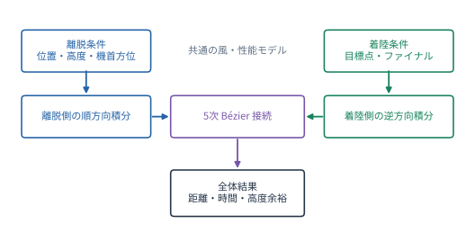
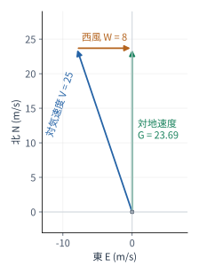
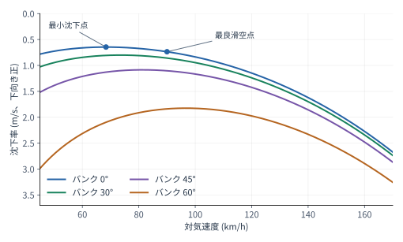
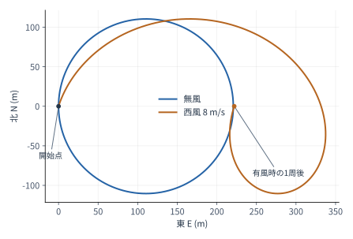
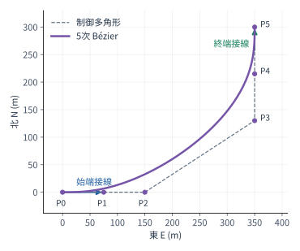
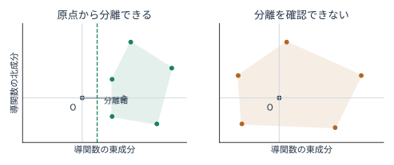
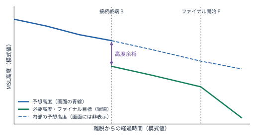

# Glider Landing Planner — 計算理論と数値モデル

対象実装：**v0.1.21-test**

本書は、Glider Landing Planner が入力条件から飛行経路、飛行時間、高度損失および高度余裕を算出する数理モデルを説明する。航空工学・飛行力学・数値解析の基礎知識を持ち、計算原理を理解または検証したい読者を対象とする。

本ツールは教育・机上検討用であり、実機の飛行可能性、安全余裕、着陸可否を判定するものではない。操作方法は [README](../README.md)、開発・検証手順は [DEVELOPMENT](DEVELOPMENT.md)、変更履歴は [CHANGELOG](../CHANGELOG.md) を参照されたい。

## 目次

1. [計算モデルの概要](#1-計算モデルの概要)
2. [座標系・記号・単位](#2-座標系記号単位)
3. [速度ベクトルと風モデル](#3-速度ベクトルと風モデル)
4. [滑空性能モデル](#4-滑空性能モデル)
5. [飛行経路の運動学](#5-飛行経路の運動学)
6. [離脱側・着陸側経路の構築](#6-離脱側着陸側経路の構築)
7. [5次 Bézier 曲線による経路接続](#7-5次-bézier-曲線による経路接続)
8. [全体経路と計算結果](#8-全体経路と計算結果)
9. [数値計算の成立条件](#9-数値計算の成立条件)
10. [モデルの適用限界](#10-モデルの適用限界)
11. [付録A 実装と検証の対応](#付録a-実装と検証の対応)
12. [付録B 参考文献](#付録b-参考文献)

## 1. 計算モデルの概要

### 1.1 計算の目的

離脱地点から着陸目標点までの水平経路を、指定した直線・旋回・接続曲線で構成する。各区間の速度、風、旋回バンクに応じて時間と高度損失を求め、離脱高度からの予想高度と、着陸側から逆算した必要高度を比較する。

*図1　離脱側と着陸側を個別に構築し、両端の境界状態から接続経路を評価する。*

離脱側は初期状態から時間順に積分する。着陸側は着陸目標点とファイナルの幾何学的条件から始端の必要高度を求め、時間を逆向きに積分する。二つの経路を5次 Bézier 曲線で接続し、全体の距離、時間、高度余裕を確定する。接続後の着陸側予想高度には逆算済みの経路を再利用し、水平運動を重複計算しない。

### 1.2 物理モデルの仮定

本モデルは準定常・質点近似（quasi-steady point-mass model）による飛行経路の運動学モデルである。機体姿勢の運動方程式を直接解くのではなく、次の仮定により必要な計算を行う。

| 対象 | 仮定 |
| --- | --- |
| 水平運動 | 着陸地点基準の局所水平面内で計算する |
| 鉛直運動 | 沈下率を時間積分する。鉛直気流はない |
| 風 | 空間・時間・高度によらない一様な水平風 |
| 滑空性能 | 浅い定常滑空と放物線抗力極線を仮定する |
| 旋回 | 一定対気速度・一定バンクの協調旋回 |
| レグ間の遷移 | 速度・バンク・指定方位の変更は瞬間的とする |
| 接続 | 対地経路を幾何学的に構成し、その追従に必要なバンクを逆算する |
| ファイナル | 指定パス角の幾何学的目標線と自然沈下による予想高度を別に扱う |

対気速度の入力値は空力性能の速度として用いると同時に、浅い滑空を仮定して水平対気速度として使用する。鉛直速度成分を含む真対気速度との厳密な分離、IAS/TAS換算は行わない。

### 1.3 入力と計算量

主要な入力は離脱地点・高度・機首方位、着陸目標点・標高・進入真方位、ファイナル長・パス角、基準対気速度・レグ個別速度、最大滑空比と最良滑空速度、風向・風速、最大バンク角、直線・旋回レグおよび接続ハンドル長である。

主な出力は各レグの水平経路・時間・距離・高度、接続曲線の最大必要バンク、全体の推定総距離・総飛行時間、チェックポイント高度および高度余裕である。計算状態は未設計、不成立、計算成立に区別する（第8・9章）。

## 2. 座標系・記号・単位

### 2.1 基本規約

水平座標は東・北の順に並べた局所平面座標とする。高度はMSL（平均海面基準）で独立に保持する。水平座標の方位と曲率は異なる符号規約を持つため、以下を明示する。

| 量 | 規約 |
| --- | --- |
| 東・北座標 | 東向き・北向きを正 |
| 高度 | 上向きを正 |
| 沈下率 | 下向きを正 |
| 機首方位・対地航跡方位 | 北を0°、東を90°、時計回りを正とする真方位 |
| 風向 | 風が吹いてくる真方位 |
| バンク角 | 右旋回を正、左旋回を負 |
| 平面曲率 | 東・北座標系の左曲がりを正 |
| 磁気偏角 | 東偏を正。地図補助方位線の表示にのみ使用 |

### 2.2 主要記号

本書ではコード上の短い変数名と物理量を区別し、記号の重複を避ける。方位・バンクは数式内では原則ラジアン、実装の `*Deg` は度である。度で評価する式には添字または度記号を付す。

| 記号 | 定義 | 単位 |
| --- | --- | --- |
| $\boldsymbol{x}=(x_E,x_N)^\mathsf{T}$ | 局所東・北座標 | m |
| $H$ | MSL高度 | m |
| $t,s$ | 累積時間・累積水平対地距離 | s, m |
| $V,G,W$ | モデル上の対気速度・対地速度・風速 | m/s |
| $\boldsymbol v_a,\boldsymbol v_g,\boldsymbol v_w$ | 対気・対地・風の水平速度ベクトル | m/s |
| $\psi,\chi,\theta_w$ | 機首方位・対地航跡方位・風向 | rad |
| $\phi,\gamma_f$ | 符号付きバンク角・ファイナルパス角（降下を正） | rad |
| $\omega$ | 機首方位変化率 | rad/s |
| $g$ | 重力加速度（9.80665） | m/s² |
| $w$ | 沈下率 | m/s |
| $E_{\max},V_{\mathrm{best}}$ | 最大滑空比・最良滑空速度 | 無次元, m/s |
| $a_s,b_s$ | 沈下モデルの有害抗力側・誘導抗力側係数 | s²/m², m²/s² |
| $\rho,m,S$ | 空気密度・機体質量・翼面積（理論導出用） | kg/m³, kg, m² |
| $C_L,C_D,C_{D0},k_i$ | 揚力係数・抗力係数・ゼロ揚力抗力係数・誘導抗力係数の係数 | 無次元 |
| $\boldsymbol A,\boldsymbol B$ | 接続の始端・終端位置 | m |
| $l_A,l_B$ | Bézier始端・終端ハンドル長 | m |
| $\boldsymbol C(u),u$ | Bézier曲線・曲線パラメータ | m, 無次元 |
| $\kappa$ | 符号付き対地曲率 | 1/m |
| $\boldsymbol\tau,\boldsymbol\nu$ | 単位接線・平面左法線 | 無次元 |

### 2.3 WGS84から局所水平面への変換

入力地点はWGS84楕円体の緯度 $\varphi$・経度 $\lambda$ である。着陸目標点を原点とし、地心地球固定座標（ECEF）を経由して局所東・北成分を求める。WGS84の長半径 $a_\oplus$、扁平率 $f_\oplus$ および離心率の二乗 $e_\oplus^2$ は [1] に基づく。

$$
a_\oplus=6378137\ \mathrm{m},\qquad
f_\oplus=\frac{1}{298.257223563},\qquad
e_\oplus^2=f_\oplus(2-f_\oplus).
$$

卯酉線曲率半径を $R_\nu(\varphi)=a_\oplus/\sqrt{1-e_\oplus^2\sin^2\varphi}$ とし、水平座標の変換には楕円体高 $h_e=0$ を使用する。

$$
\boldsymbol r(\varphi,\lambda)=
\begin{bmatrix}
R_\nu\cos\varphi\cos\lambda\\
R_\nu\cos\varphi\sin\lambda\\
R_\nu(1-e_\oplus^2)\sin\varphi
\end{bmatrix}.
$$

着陸地点の緯度・経度を $\varphi_0,\lambda_0$、ECEF差を $\Delta\boldsymbol r=\boldsymbol r-\boldsymbol r_0$ とすると、東・北成分は

$$
\begin{bmatrix}x_E\\x_N\end{bmatrix}=
\begin{bmatrix}
-\sin\lambda_0 & \cos\lambda_0 & 0\\
-\sin\varphi_0\cos\lambda_0 & -\sin\varphi_0\sin\lambda_0 & \cos\varphi_0
\end{bmatrix}\Delta\boldsymbol r.
$$

局所鉛直成分は経路計算には使用しない。逆変換では上式の行ベクトルを局所基底 $\boldsymbol e_E,\boldsymbol e_N$ として、接平面上の点を $\boldsymbol r^*=\boldsymbol r_0+x_E\boldsymbol e_E+x_N\boldsymbol e_N$ に戻す。経度は `atan2`、楕円体緯度は8回の反復によって求める（極点近傍の特別処理あり）。接平面上の点を楕円体表面に逆射影しているわけではないため、厳密な逆変換ではない。

離脱地点には射影前の球面距離制限を適用する。地球中心から見た二地点の単位ベクトルを $\boldsymbol r_1^u,\boldsymbol r_2^u$ とすると、実装の距離は

$$
d_{\mathrm{geo}}=6371008.8\,\operatorname{atan2}
\left(\lVert\boldsymbol r_1^u\times\boldsymbol r_2^u\rVert,
\boldsymbol r_1^u\cdot\boldsymbol r_2^u\right).
$$

この距離および生成経路の局所半径を原則50 km以内に制限する。前者は全球的に離れた地点の誤射影を防ぎ、後者は局所平面近似の範囲を管理する。具体的な連続区間の評価方法は第9章に示す。

### 2.4 高度と表示単位

計算内部の高度はMSLのメートルである。滑空場基準高度は着陸標高 $H_L$ を差し引いた

$$
H_{\mathrm{rel}}=H-H_L
$$

である。地形標高を使用しないため、これは各地点のAGL（地表面基準高度）ではない。高度プロファイルはMSL、チェックポイント表は滑空場基準高度とMSL高度を表示する。

単位換算は $1\ \mathrm{ft}=0.3048\ \mathrm{m}$、$1\ \mathrm{km/h}=1/3.6\ \mathrm{m/s}$ を使用する。磁気方位から真方位への換算 $\theta_{\mathrm{true}}=\theta_{\mathrm{mag}}+D_m$（東偏正）は地図の補助方位線に限り、飛行計算の方位は一貫して真方位とする。

## 3. 速度ベクトルと風モデル

### 3.1 対地速度の合成

北基準・時計回りの単位ベクトルを $\boldsymbol u(\theta)=(\sin\theta,\cos\theta)^\mathsf{T}$ と定義する。風向は吹いてくる方位なので、風ベクトルの向きはその反対である。

$$
\boldsymbol v_w=-W\boldsymbol u(\theta_w),\qquad
\boldsymbol v_a=V\boldsymbol u(\psi),\qquad
\boldsymbol v_g=\boldsymbol v_a+\boldsymbol v_w.
$$

対地速度と対地航跡方位（Ground Track、UIでは「航跡方位」）は

$$
G=\lVert\boldsymbol v_g\rVert,\qquad
\chi=\operatorname{atan2}(v_{g,E},v_{g,N})\pmod{2\pi}.
$$

機首方位指定（`heading`）では、指定した機首方位を用いてこのベクトル和を求める。横風がある場合、機首方位と対地航跡方位は一致しない。

### 3.2 航跡方位指定と風三角形

航跡方位指定（`ground-track`）では、指定した対地航跡方位 $\chi$ に沿う速度ベクトルが必要である。単位接線 $\boldsymbol\tau=\boldsymbol u(\chi)$ と左法線 $\boldsymbol\nu=(-\tau_N,\tau_E)^\mathsf{T}$ に風を分解し、$W_t=\boldsymbol v_w\cdot\boldsymbol\tau$、$W_n=\boldsymbol v_w\cdot\boldsymbol\nu$ とする。

$$
\boldsymbol v_a=G\boldsymbol\tau-\boldsymbol v_w,
\qquad
\lVert G\boldsymbol\tau-\boldsymbol v_w\rVert^2=V^2.
$$

展開すると

$$
G^2-2W_tG+W_t^2+W_n^2-V^2=0.
$$

よって、風三角形の解は

$$
G=W_t\pm\sqrt{V^2-W_n^2}.
$$

本モデルでは $W<V$ に制限する。このとき $V^2-W_n^2>W_t^2$ であるから、正方向に進む解は一意である。$Q=\sqrt{V^2-W_n^2}$ と置き、正の平方根を採用する。

$$
G=W_t+Q,\qquad
\psi=\operatorname{atan2}(G\tau_E-v_{w,E},G\tau_N-v_{w,N}).
$$

実装は垂直風成分の二乗を $\lVert\boldsymbol v_w\rVert^2-W_t^2$ から計算し、丸め誤差による負値をゼロに制限する。平方根の中身が正でない場合、または第9章の対地速度下限を満たさない場合は解を返さない。

*図2　北へ進む場合の風三角形。対気速度25 m/s、西風8 m/sの数学モデル上の例。機首は北より西側を向く。*

$W\ge V$ では正の解が複数存在する場合もあり、解が一意でない。本ツールでは航跡方位指定、Bézier接続、ファイナルをこの条件で不成立とする。機首方位指定は風速による一律制限を設けず、対地速度下限を別途適用する。

## 4. 滑空性能モデル

### 4.1 放物線抗力極線

本モデルは定常・浅い滑空に対する放物線抗力極線 [2–4] を仮定する。

$$
C_D=C_{D0}+k_i C_L^2,\qquad k_i=\frac{1}{\pi e_o AR}.
$$

$e_o$ はオズワルド効率係数、$AR$ はアスペクト比である。動圧 $q_d=\rho V^2/2$、揚力 $F_L=q_dSC_L$、抗力 $F_D=q_dSC_D$ とする。浅い滑空中の定常協調旋回で鉛直方向の力がほぼ釣り合うと仮定すると、

$$
F_L\cos\phi\simeq mg,\qquad
C_L\simeq\frac{mg}{q_dS\cos\phi}.
$$

これを抗力式に代入する。

$$
F_D\simeq\frac{\rho S C_{D0}}{2}V^2+
\frac{2k_i(mg)^2}{\rho S V^2\cos^2\phi}.
$$

### 4.2 沈下率の導出

無推力・定速滑空で鉛直気流がないとき、位置エネルギーの減少率と抗力による仕事率の関係は $mgw=F_DV$ である。したがって、上記の近似抗力を用いると

$$
w(V,\phi)=\frac{\rho S C_{D0}}{2mg}V^3+
\frac{2k_i mg}{\rho S}\frac{1}{V\cos^2\phi}.
$$

機体諸元を二つの等価性能係数に集約する。

$$
a_s=\frac{\rho S C_{D0}}{2mg},\qquad
b_s=\frac{2k_i mg}{\rho S}.
$$

実装が使用する沈下率式は

$$
w(V,\phi)=a_sV^3+\frac{b_s}{V\cos^2\phi}.
$$

第1項は有害抗力側、第2項は誘導抗力側の寄与を表す。荷重倍数は浅い定常旋回で $n_z\simeq1/\cos\phi$ であり、誘導抗力が揚力の二乗に比例するため、第2項は無バンク時の $n_z^2$ 倍になる。

### 4.3 最大滑空比と最良滑空速度からの係数決定

無バンク時の滑空比は浅い滑空の近似の下で

$$
E(V)\simeq\frac{V}{w(V,0)}=\frac{1}{a_sV^2+b_s/V^2}.
$$

$V=V_{\mathrm{best}}$ で分母が最小になる条件から

$$
\frac{d}{dV}(a_sV^2+b_s/V^2)=2a_sV-\frac{2b_s}{V^3}=0,
\qquad b_s=a_s V_{\mathrm{best}}^4.
$$

最大滑空比 $E_{\max}$ を代入すると、

$$
E_{\max}=\frac{1}{2a_sV_{\mathrm{best}}^2},\qquad
 a_s=\frac{1}{2E_{\max}V_{\mathrm{best}}^2},\qquad
 b_s=\frac{V_{\mathrm{best}}^2}{2E_{\max}}.
$$

したがって、本ツールでは最大滑空比と最良滑空速度の二つの入力から係数を決定できる。係数の次元はそれぞれ s²/m²、m²/s²であり、沈下率式の両項はm/sになる。重量・翼面積・密度・実測ポーラーを独立入力としては扱わない。

### 4.4 最小沈下速度とモデルの特性

無バンク時の最小沈下速度 $V_{\mathrm{ms}}$ は $dw/dV=0$ より

$$
3a_sV^2-\frac{b_s}{V^2}=0,\qquad
V_{\mathrm{ms}}=\left(\frac{b_s}{3a_s}\right)^{1/4}
=\frac{V_{\mathrm{best}}}{3^{1/4}}.
$$

このとき $w_{\mathrm{ms}}=2V_{\mathrm{best}}/(3^{3/4}E_{\max})$ となる。最良滑空速度は水平距離当たりの高度損失を最小にする無風のモデル速度であり、最小沈下速度は時間当たりの高度損失を最小にする速度である。この導出はモデルの性質を説明するもので、アプリケーションが飛行速度を自動最適化することを意味しない。

*図3　最大滑空比34、最良滑空速度90 km/hの理論ポーラー。速度範囲全体での実機性能を意味せず、失速領域を切り取った図でもない。*

同じ入力条件での計算例を示す。無バンク時の最小沈下速度は約68.4 km/h、最小沈下率は約0.645 m/sである。最良滑空速度でバンクを変えると次のようになる。

| バンク角 | 荷重倍数の近似 | 誘導抗力項の倍率 | 沈下率（m/s） |
| ---: | ---: | ---: | ---: |
| 0° | 1.000 | 1.000 | 0.735 |
| 30° | 1.155 | 1.333 | 0.858 |
| 45° | 1.414 | 2.000 | 1.103 |
| 60° | 2.000 | 4.000 | 1.838 |

### 4.5 浅い滑空近似の適用範囲

入力速度を真対気速度とみなした場合の鉛直成分比 $r=w/V$ は、降下角 $\gamma$ に対して $r=\sin|\gamma|$ である。実際の水平成分は $V\sqrt{1-r^2}$ となるため、入力速度で水平速度を代用する際の真対気速度に対する相対的な成分差は $1-\sqrt{1-r^2}$ である。

| 沈下率比 $r$ | 対応する成分差 | 実装の扱い |
| --- | ---: | --- |
| $0\lt r\le0.1$ | 最大約0.50% | 通常計算 |
| $0.1\lt r\le0.2$ | 最大約2.02% | 近似に関する警告 |
| $r\gt0.2$ | 上記の近似範囲外 | 高度評価無効 |

比率の閾値は工学的なモデル制約であり、抗力・旋回率・高度損失の総合誤差を保証する基準ではない。非有限値、正でない速度・沈下率、絶対バンク角90°以上なども無効とする。沈下率式そのものの評価と適用可否の判定は分離し、高度が無効な場合はその計算方向へ無効状態を伝播させる。

## 5. 飛行経路の運動学

### 5.1 状態と基礎方程式

各飛行状態は水平位置、高度、機首方位、対地航跡方位、対気・対地速度、バンク角、累積時間・距離、および高度の有効性を持つ。レグは直線または旋回から構成される。各レグの対気速度は個別速度が指定されていればその値、なければ基準対気速度を使用する。

$$
\frac{d\boldsymbol x}{dt}=\boldsymbol v_g,\qquad
\frac{dH}{dt}=-w(V,\phi),\qquad
\frac{ds}{dt}=G.
$$

時間増分 $\Delta t$ は実飛行順の積分で正、逆方向積分で負とする。逆方向でも機首方位や左右旋回の定義は実際の飛行方向に従い、風向・バンク符号を反転させない。

### 5.2 直線飛行

指定距離 $L$ は水平対地距離である。一定速度・一定風の直線では、機首方位指定または航跡方位指定により一定の $\boldsymbol v_g$ を決める。方位指定がなければ、そのレグの開始時の対応する方位を継承する。

所要時間は $T=L/G$。積分方向を $\eta=+1$（順方向）または $-1$（逆方向）とすると、

$$
\Delta\boldsymbol x=\eta\boldsymbol v_gT,\qquad
\Delta H=-\eta w(V,0)T,\qquad
\Delta s=\eta L.
$$

連続解が線形なので、サンプル分割は主として描画と状態の記録のために行う。分割数は $n_\ell=\max(1,\min(2000,\lceil L/20\rceil))$。各ステップの時間は $\eta T/n_\ell$ である。

### 5.3 一定バンクの協調旋回

浅い滑空の協調旋回で揚力の鉛直成分と水平成分を考えると、

$$
F_L\cos\phi\simeq mg,\qquad
F_L\sin\phi\simeq mV\dot\psi.
$$

二式の比より機首方位変化率は

$$
\omega=\dot\psi=\frac{g\tan\phi}{V}.
$$

無風の場合の旋回半径と機首方位変化量 $\Delta\psi$ の所要時間は

$$
R=\frac{V^2}{g|\tan\phi|},\qquad
T=\frac{|\Delta\psi|}{|\omega|}.
$$

有風の場合は、対気速度ベクトルの回転に一定の風ベクトルを合成する。一定 $\omega\ne0$ に対する水平位置の解析解は、初期方位 $\psi_0$、初期位置 $\boldsymbol x_0$ を用いて

$$
\begin{aligned}
x_E(t)&=x_{E,0}+\frac{V}{\omega}[\cos\psi_0-\cos(\psi_0+\omega t)]+v_{w,E}t,\\
x_N(t)&=x_{N,0}+\frac{V}{\omega}[\sin(\psi_0+\omega t)-\sin\psi_0]+v_{w,N}t.
\end{aligned}
$$

この解析解は数値積分の検証に使用できるが、実装の位置更新には後述の重み付き積分を使用する。1周後の水平変位は風による $\boldsymbol v_wT$ であり、有風時の対地経路は一般に円ではない。

*図4　対気速度25 m/s、右バンク30°、開始機首方位0°の360°機首方位変化。解析解による比較。*

### 5.4 旋回角指定と旋回前後の方位指定

UIの「旋回角」は選択した飛行方式における累積方位変化量（正値）を意味する。機首方位指定では機首方位変化量 $\Delta\psi$ の大きさ、航跡方位指定では対地航跡方位変化量 $\Delta\chi$ の大きさを指定する。有風時には両者は一般に一致しない。後者は地上の円弧半径や地上旋回率を一定に制御するモデルではない。

「旋回角を指定」（`angle`）では保存された正の角度 $\alpha_{\deg}$ を使用する。方位指定（`target`）では、離脱側は旋回後、着陸側は旋回前の機首方位または航跡方位を境界条件とする。使用する方位量を $\zeta_{\deg}$（機首方位または対地航跡方位）、右旋回を $\sigma=+1$、左旋回を $\sigma=-1$ とすると、

$$
\alpha_0=\operatorname{mod}_{360}\left[\sigma\eta
(\zeta_{\mathrm{target},\deg}-\zeta_{\mathrm{boundary},\deg})\right].
$$

余りが0°（実装では360°境界の $10^{-9}$° 未満の差を含む）なら基準解を360°とする。基準解に360°の非負整数倍を加えた候補から直前の保存角度に最も近い正の角度を選び、同距離なら小さい方を採る。これにより編集前の周回数を可能な限り維持する。計算が完了した方位指定レグの解決済み角度は次回の選択基準として保持する。

### 5.5 航跡方位指定における終端機首方位

一定風で $W<V$ のとき、対地航跡方位の機首方位に対する微分は

$$
\frac{d\chi}{d\psi}=\frac{V(V+\boldsymbol v_w\cdot\boldsymbol u(\psi))}{G^2}>0.
$$

この式は速度ベクトルの方位角を微分して得られる。分子は $V(V-W)>0$ 以上なので、方位を連続的に展開すれば両方位の変化方向は一致する。指定する累積対地航跡方位変化量から終端対地航跡方位を求め、風三角形により終端機首方位を直接計算できる。

実装では指定角の完全周回数 $k=\lfloor\alpha_{\deg}/360\rfloor$ と余りを分離し、余りに相当する機首方位変化量を旋回・積分方向に沿って0°〜360°未満に求める。完全周回の $360k$ を加えた機首方位変化量に基づいて積分する。余りが $10^{-10}$° 未満の場合は完全周回のみとする。

旋回の全区間で対地速度下限を評価する。方位を連続的に展開した区間内では

$$
G^2(\psi)=V^2+W^2-2VW\cos(\psi-\theta_w).
$$

区間が風上方位 $\theta_w+2\pi k$ を含む場合は最小値 $|V-W|$、含まない場合は両端の対地速度の小さい方を採る。この解析的最小値の評価は機首方位指定にも共通であり、単にサンプル点の最小値を用いるものではない。

### 5.6 旋回の数値積分

機首方位は $\psi_{i+1}=\psi_i+\omega\Delta t$ により更新する。速度は一定バンクの方位変化から評価できるため、位置更新は次の3点の重み付き積分（Simpson則に相当するRK4の重み）を使用する。

$$
\boldsymbol x_{i+1}=\boldsymbol x_i+\frac{\Delta t}{6}
[\boldsymbol v_g(\psi_i)+4\boldsymbol v_g(\psi_i+\omega\Delta t/2)
+\boldsymbol v_g(\psi_i+\omega\Delta t)].
$$

高度は一定沈下率、累積対地距離は対地速度の台形則で更新する。

$$
H_{i+1}=H_i-w(V,\phi)\Delta t,\qquad
s_{i+1}=s_i+\tfrac12(G_i+G_{i+1})\Delta t.
$$

実効機首方位変化量（度）を $\beta_{\deg}$ とすると、分割角の基準は $\max(0.25^\circ,\beta_{\deg}/50000)$、分割数はその基準で切り上げた値を1〜50,000の範囲に制限した値である。実際の時間刻みは全旋回時間を等分する。2°を超える分割角が必要な場合は不成立とする。各ステップの累積方位変化量と指定角との差が0.02°を超えた場合も不成立となる。経路全体のサンプル予算は第9章に示す。

## 6. 離脱側・着陸側経路の構築

### 6.1 離脱側の順方向積分

離脱地点を局所座標へ変換し、離脱MSL高度・機首方位・基準対気速度を初期状態とする。時間・距離の初期値はゼロである。離脱側レグを実飛行順に積分し、その終端状態を接続始端 $\boldsymbol A$ の条件とする。

各レグでは実効速度に切り替え、直線の指定方位や旋回バンクを適用する。速度変更に伴う運動エネルギーや方位変更の遷移区間は計算しない。

### 6.2 ファイナルの幾何学的境界

着陸目標点を $\boldsymbol x_L$、着陸標高を $H_L$、進入真方位を $\chi_f$、ファイナルの水平対地距離を $L_f$、指定パス角を $\gamma_f$ とする。ファイナル開始位置 $\boldsymbol x_F$ と必要高度 $H_F$ は

$$
\boldsymbol x_F=\boldsymbol x_L-L_f\boldsymbol u(\chi_f),\qquad
H_F=H_L+L_f\tan\gamma_f.
$$

ファイナル開始からの水平距離 $\xi$ に対する幾何学的目標線は

$$
H_{\mathrm{target}}(\xi)=H_L+(L_f-\xi)\tan\gamma_f,\qquad 0\le\xi\le L_f.
$$

ファイナル長600 m、パス角6°の場合、開始時の滑空場基準高度は約63.06 m（206.9 ft）となる。これはエアブレーキやフレアで実際に達成できる進入角を評価したものではない。

ファイナルの対気速度 $V_f$ は直前の着陸側レグの実効速度（着陸側レグがない場合は基準対気速度）を継承する。進入真方位に対する風三角形を一度解き、ファイナルの機首方位・対地速度 $G_f$ を求める。これを逆算境界、ファイナルの時間 $L_f/G_f$ および自然沈下の高度損失 $w(V_f,0)L_f/G_f$ に共用する。風補正や沈下率が不成立の場合には、幾何学的目標線を有効な予想高度・所要時間と混同しない。

### 6.3 着陸側の逆方向積分

ファイナル開始状態を逆方向積分の基準とし、時間・距離をゼロに設定する。着陸側レグは保存上は実飛行順であるが、計算は逆順・負時間で行う。

高度の時間微分は $-w$ であるため、負時間積分により上流ほど必要高度が高くなる。全レグを逆算した後、サンプルとレグを実飛行順に並べる。最上流の着陸側始端 $\boldsymbol B$ の状態が、接続終端の位置・方位・曲率・必要高度を定める。

### 6.4 境界状態の管理

各レグの始端・終端は実際の計算サンプルの両端から定める。隣接するレグの位置・高度・時刻・累積距離について整合性を検査する。速度や機首方位の瞬間変更は警告として扱うが、位置・高度などの不整合はエラーとする。着陸側終端の機首方位・対地航跡方位はファイナル開始状態との一致を検査する（許容差は第9章）。

レグが途中で停止した場合は、計算済みサンプルと未完了状態を保持し、後続の積分を停止する。未到達の正式チェックポイントや全体の計算成立を生成しない。

## 7. 5次 Bézier 曲線による経路接続

### 7.1 境界条件と制御点

離脱側終端 $\boldsymbol A$ と着陸側始端 $\boldsymbol B$ を結ぶ水平経路に、端点位置・接線方向・符号付き曲率を指定できる5次 Bézier 曲線を採用する。これは位置、接線、曲率の幾何学的連続性を意図した構成であり、時間に関する加速度・ロール速度の連続性まで保証するものではない。

両端の対地航跡方位から単位接線 $\boldsymbol\tau_A,\boldsymbol\tau_B$ と左法線 $\boldsymbol\nu_A,\boldsymbol\nu_B$ を定義する。両端の曲率を $\kappa_A,\kappa_B$ とし、正のハンドル長 $l_A,l_B$ を用いて制御点を次のように定義する。

$$
\begin{aligned}
\boldsymbol P_0&=\boldsymbol A,\\
\boldsymbol P_1&=\boldsymbol A+l_A\boldsymbol\tau_A,\\
\boldsymbol P_2&=\boldsymbol A+2l_A\boldsymbol\tau_A+\tfrac54\kappa_A l_A^2\boldsymbol\nu_A,\\
\boldsymbol P_3&=\boldsymbol B-2l_B\boldsymbol\tau_B+\tfrac54\kappa_B l_B^2\boldsymbol\nu_B,\\
\boldsymbol P_4&=\boldsymbol B-l_B\boldsymbol\tau_B,\\
\boldsymbol P_5&=\boldsymbol B.
\end{aligned}
$$

*図5　両端曲率ゼロの制御点配置例。一般には曲率に対応する法線方向の項が $\boldsymbol P_2,\boldsymbol P_3$ に加わる。図は幾何学の説明例で、計画成立性を示さない。*

### 7.2 Bézier曲線と導関数

Bernstein基底 $b_{i,n}(u)=\binom ni(1-u)^{n-i}u^i$ による曲線と導関数は [5] に基づき、

$$
\begin{aligned}
\boldsymbol C(u)&=\sum_{i=0}^5 b_{i,5}(u)\boldsymbol P_i,\\
\boldsymbol C'(u)&=5\sum_{i=0}^4 b_{i,4}(u)(\boldsymbol P_{i+1}-\boldsymbol P_i),\\
\boldsymbol C''(u)&=20\sum_{i=0}^3 b_{i,3}(u)(\boldsymbol P_{i+2}-2\boldsymbol P_{i+1}+\boldsymbol P_i),\\
&\hspace{4em}0\le u\le1.
\end{aligned}
$$

パラメータ $u$ は無次元であり、両導関数の単位はmである。接線・曲率は導関数ノルムが正のとき

$$
\boldsymbol\tau(u)=\frac{\boldsymbol C'(u)}{\lVert\boldsymbol C'(u)\rVert},\qquad
\kappa(u)=\frac{C'_E C''_N-C'_N C''_E}{\lVert\boldsymbol C'(u)\rVert^3}.
$$

端点の制御点を代入すると、始端で $\boldsymbol C'(0)=5l_A\boldsymbol\tau_A$、$\boldsymbol C''(0)=25\kappa_A l_A^2\boldsymbol\nu_A$ となる。平面の単位接線と左法線の外積は1なので、

$$
\kappa(0)=\frac{5l_A\,25\kappa_A l_A^2}{(5l_A)^3}=\kappa_A.
$$

同様に終端で $\boldsymbol C'(1)=5l_B\boldsymbol\tau_B$、$\boldsymbol C''(1)=25\kappa_B l_B^2\boldsymbol\nu_B$、$\kappa(1)=\kappa_B$ を得る。係数 $5/4$ は端点曲率の条件から定まる。

### 7.3 隣接レグからの端点曲率

一定風の下では、機首方位が $\omega$ で変化する場合の対地速度微分は

$$
\dot{\boldsymbol v}_g=V\omega(\cos\psi,-\sin\psi)^\mathsf{T}.
$$

対地曲率は平面運動の定義から

$$
\kappa_{\mathrm{end}}=
\frac{v_{g,E}\dot v_{g,N}-v_{g,N}\dot v_{g,E}}{G^3}.
$$

離脱側終端と着陸側始端の各々の対気速度、機首方位、バンクおよび共通の風からこの曲率を求める。バンクの絶対値が0.01°未満なら曲率をゼロとする。旋回に接続する場合でも端点曲率を一律にゼロへ強制しない。

### 7.4 対地曲率から必要バンク角を求める

接続区間では離脱側終端の対気速度 $V_c$ を一定とし、曲線の単位接線に沿って飛ぶための機首方位を風三角形で求める。以下の式の $V$ は $V_c$ である。

符号付き曲率は左曲がりを正、対地航跡方位は時計回りを正とするので

$$
\dot\chi=-\kappa G.
$$

また、第5章の微分式と風三角形の関係から、正の平方根 $Q=\sqrt{V^2-W_n^2}$ について

$$
V(V+\boldsymbol v_w\cdot\boldsymbol u(\psi))
=\boldsymbol v_a\cdot\boldsymbol v_g=GQ,
\qquad \dot\chi=\frac{Q}{G}\dot\psi.
$$

二式と協調旋回率を組み合わせると

$$
\omega=-\frac{\kappa G^2}{Q},\qquad
\phi=\arctan\left(-\frac{V\kappa G^2}{gQ}\right).
$$

無風では $G=Q=V$ なので $\phi=\arctan(-\kappa V^2/g)$ に帰着する。曲率とバンクが逆符号になることは、第2章の符号規約と整合する。

端点で位置・対地接線・幾何曲率が一致しても、接続終端で速度が変更される場合には必要バンクや機首方位が連続するとは限らない。同一速度の場合は機首方位の連続性を確認し、速度差がある場合には限定された瞬間変更を警告する。境界条件の具体的な許容差は第9章に示す。

### 7.5 正則性と凸包による判定

接線方位と曲率を評価するには $\lVert\boldsymbol C'(u)\rVert>0$ が必要である。有限個のサンプル点が正であっても、その間に導関数が消失する点が存在し得る。

導関数は制御点 $\boldsymbol D_i=5(\boldsymbol P_{i+1}-\boldsymbol P_i)$ を持つ4次 Bézier 曲線である。Bernstein基底が非負で総和1であるため、導関数ベクトルは制御点の凸包に含まれる。ある単位ベクトル $\boldsymbol d$ に対して、すべての導関数制御点が

$$
\boldsymbol d\cdot\boldsymbol D_i>\varepsilon_d
$$

を満たすなら、全区間の導関数ノルムも $\varepsilon_d$ より大きい。

*図6　左は分離軸で正則性の十分条件を確認できる例、右は凸包だけでは判定できない例。*

実装では各区間の導関数制御点の和を正規化した方向を分離軸として試す。端点で下限以下を観測すれば不成立、十分条件が確認できなければde Casteljau法によって導関数曲線を二分する。分割後も元のパラメータ $u$ に対する導関数の値を維持する。下限 $\varepsilon_d=10^{-5}\ \mathrm{m}$、最大深さ16、評価予算20,000ノード／候補とする。

有限予算内で全区間を確認できない場合も不成立とし、実際の下限違反と判定不能を区別する。粗評価・詳細評価の両方に適用する。これは浮動小数点数値演算における保守的な十分条件であって厳密な区間証明ではなく、数学的に正則な曲線を拒否する場合がある。非正則・判定不能の曲線は、有限かつ領域内なら編集用プレビューとして保持するが、飛行計算サンプルとしては使用しない。

### 7.6 曲線長、時間および高度損失

連続曲線に対する理論上の距離、時間、高度損失は

$$
\begin{aligned}
L_c&=\int_0^1\lVert\boldsymbol C'(u)\rVert\,du,\\
T_c&=\int_0^1\frac{\lVert\boldsymbol C'(u)\rVert}{G(u)}\,du,\\
\Delta H_c&=\int_0^1\frac{w(V_c,\phi(u))\lVert\boldsymbol C'(u)\rVert}{G(u)}\,du.
\end{aligned}
$$

実装は等間隔の $u$ における離散サンプルで近似する。端点間距離 $d_{AB}=\lVert\boldsymbol B-\boldsymbol A\rVert$ から通常評価の分割数を

$$
n_c=\min(2000,\max(160,\lceil(d_{AB}+l_A+l_B)/3\rceil))
$$

とする。粗評価は56分割である。分割数の決定に用いる3の単位はmであり、実際の弧長を3 m間隔に分割する方式ではない。隣接点の弦長 $\delta s_i$ と、両端の対地速度・沈下率を用いて

$$
\begin{aligned}
\delta s_i&=\lVert\boldsymbol C(u_{i+1})-\boldsymbol C(u_i)\rVert,\\
\delta t_i&=\frac{\delta s_i}{2}\left(\frac{1}{G_i}+\frac{1}{G_{i+1}}\right),\\
\delta H_{\mathrm{loss},i}&=\tfrac12(w_i+w_{i+1})\delta t_i.
\end{aligned}
$$

それぞれを総和して距離・時間・高度損失を算出する。最後の式は時間増分に対する沈下率の台形近似であり、$w/G$ を $u$ について直接台形積分した式とは区別する。制約評価の追加サンプルはこの積分メッシュに挿入しない。

### 7.7 成立性の追加評価

通常評価では基準メッシュに加え、絶対バンク角の局所最大値候補の近傍を黄金分割型探索で評価する（最大24反復、区間幅 $10^{-8}$ 以下で停止）。さらに各区間の中点を評価し、以下の場合に追加分割を行う。

- 中点の絶対バンク角と両端の平均絶対バンク角との差が0.05°を超える。
- 制約近傍（対地速度0.1 m/s未満、導関数ノルム $10^{-3}$ m未満、最大バンク設定値との差0.5°以内、沈下率比0.19以上）の区間で、初回評価または最大バンク増分・中点差が $10^{-4}$° を超える。

追加分割の最大深さは8、追加評価の予算は20,000点／候補である。予算内で評価を確定できない場合も不成立とする。最大バンクは実際に評価した点での絶対値の最大であり、連続曲線全体の厳密な上界ではない。

自己交差は基準メッシュの折れ線と、追加評価点を含む折れ線で検査する。非隣接線分の交差・接触・重複、隣接線分の折り返しおよび極短線分を対象とする。通常の隣接線分の共有端点は交差とみなさない。有限折れ線の判定であり、連続曲線のすべての自己交差を保証するものではない。

### 7.8 自動接続候補の探索

自動接続はハンドル長の有限候補探索であり、連続最適化ではない。端点間距離に対して

$$
l_A=\max(10,r_A d_{AB}),\qquad l_B=\max(10,r_B d_{AB}),\qquad
r_A,r_B\in\{0.16,0.27,0.40,0.58,0.80,1.10\}
$$

の最大36組を生成する。ハンドル長の保存範囲（1〜50,000 m）を逸脱する候補は除外する。共通境界が不成立なら探索を省略する。端点距離1 m未満の場合には5 mの両ハンドルを直接評価する特別処理がある。

粗評価で飛行サンプルが得られた候補の順位付けには、次の経験的スコアを用いる。

$$
J=P_{\mathrm{invalid}}+120\phi_{\max,\deg}+L_c
+10^4\max(0,\phi_{\max,\deg}-\phi_{\mathrm{limit},\deg}).
$$

ここで $P_{\mathrm{invalid}}$ は粗評価成立なら0、不成立なら $10^7$。サンプルがない場合やスコアが非有限の場合は無限大とする。これは数値を重み付けした順位付け指標であり、物理単位を持つエネルギーや最小時間の目的関数ではない。角度の重みは度、距離の重みはmで評価した数値に適用する。

スコア昇順（同点は生成順）に通常精度で再評価し、最初に成立した候補を採用する。粗評価の最良候補が詳細評価で不成立なら次候補を確認する。全候補が不成立なら編集可能な不成立結果を返し、幾何形状を持つ候補を優先して保持する。候補を確定できない場合の初期値も保存範囲に制限する。手動調整では指定されたハンドル長の曲線を直接評価する。

探索範囲外に成立可能な経路があっても発見を保証しない。また、選択された解が候補全体の詳細評価スコア最小、最短距離、最小高度損失または大域最適解であるとは限らない。

## 8. 全体経路と計算結果

### 8.1 着陸側経路の正本化

着陸側始端 $\boldsymbol B$ の逆算必要高度を $H_{\mathrm{req},B}$、離脱側終端の予想高度を $H_{\mathrm{pred},A}$ とする。接続が成立した場合、その終端予想高度は

$$
H_{\mathrm{pred},B}=H_{\mathrm{pred},A}-\Delta H_c.
$$

着陸側始端から任意の地点までの累積自然沈下損失を $\Delta H_B(t)$ とする。同じ着陸側経路、速度、沈下モデルであれば

$$
H_{\mathrm{req}}(t)=H_{\mathrm{req},B}-\Delta H_B(t),\qquad
H_{\mathrm{pred}}(t)=H_{\mathrm{pred},B}-\Delta H_B(t).
$$

したがって

$$
H_{\mathrm{pred}}(t)=H_{\mathrm{pred},B}+H_{\mathrm{req}}(t)-H_{\mathrm{req},B}.
$$

高度そのものに依存しない沈下モデルを採用しているので、逆算した着陸側サンプルを共有するだけで予想高度を算出できる。予想高度のために水平運動を再積分しない。着陸側の時間と距離は始端でゼロとなるよう平行移動し、接続成立時には接続終端の累積時間・距離を加える。

### 8.2 ファイナルにおける二つの高度

ファイナルの必要高度系列は第6章の幾何学的目標線である。一方、自然沈下による内部の予想高度系列は、ファイナル開始地点の予想高度 $H_{\mathrm{pred},F}$ に対して

$$
H_{\mathrm{pred},f}(\xi)=H_{\mathrm{pred},F}-\frac{w(V_f,0)}{G_f}\xi.
$$

したがって、ファイナル区間の目標降下勾配と自然沈下勾配は一般に異なる。目標線を実現するためのブレーキ量は求めない。ファイナルは48分割でサンプルを構成する。

### 8.3 高度余裕の定義

画面上部の高度余裕は接続終端 $\boldsymbol B$ での予想高度と必要高度の差である。

$$
M_B=H_{\mathrm{pred},B}-H_{\mathrm{req},B}
=H_{\mathrm{pred},A}-\Delta H_c-H_{\mathrm{req},B}.
$$

正値はモデル上の余剰、負値は不足を意味する。着陸側の逆算レグ上では第8.1節より、同一点での高度差は $M_B$ に等しく一定である。ダウンウィンド開始として指定されたチェックポイントが存在する場合、同位置の予想高度と必要高度の差を別途求める。両者は評価地点が異なるが、本モデルの仮定ではファイナル開始まで同じ差になる（数値丸めを除く）。

ファイナル区間では幾何学的目標線と自然沈下の差を含むため、高度差は一般に一定ではない。高度余裕が正であることは実際の着陸安全性を保証しない。

*図7　高度系列の模式図。青実線は画面に表示する離脱側と成立した接続の予想高度、緑実線は着陸側逆算必要高度とファイナル目標線。青破線は内部で計算する予想高度の説明用であり、画面には描画しない。数値は模式的である。*

### 8.4 結果と表示の区別

高度グラフの横軸は離脱からの経過飛行時間、縦軸はMSL高度である。青線は離脱側と成立した接続の予想高度、緑線は逆算した着陸側必要高度とファイナル目標線を示す。内部の全体予想高度配列 `forwardAll` と、実際に描画する青線は同一の範囲ではない。接続点で二系列を強制的に連結しない。

未接続・不成立の場合、着陸側の時刻は接続後の実飛行時刻として確定しない。グラフは仮配置または部分計算結果を使用し、総飛行時間を評価不可とする。初期未設計では案内を表示する。高度が無効な部分は表示対象から除く。

正式チェックポイントは離脱地点、完了した離脱側レグ終端、完了した着陸側レグ始端、ファイナル開始および着陸目標点である。離脱地点と離脱側のレグ終端では予想高度、着陸側では必要高度、ファイナル境界では目標高度を用いる。未完了レグは途中経路を保持しても正式チェックポイントを生成しない。接続終端の重複チェックポイントを別途設けない。

### 8.5 計算状態と集計値

接続の `feasible` は接続曲線についての数値・幾何学・モデル制約の評価結果である。上流から伝播した高度の有効性（`altitudeValid`）は別途保持し、計画全体の判定で併せて確認する。計画全体の `valid` は、両側の必要区間が完了し、接続・境界・高度が成立し、必須数値が有限かつエラーがない状態を表す。全体指標は計算エンジンで確定する。

| 状態 | 条件の概略 | 総距離・総時間・高度余裕 |
| --- | --- | --- |
| `unplanned` | 着陸側レグなし・接続なし・エラーなし | — |
| `invalid` | 未接続（着陸側あり）または計算制約違反等 | 評価不可（内部値は `null`） |
| `valid` | 必須の経路・境界・高度・計算制約が成立 | 計算済み数値 |

総距離と総時間は、成立時の全体予想配列の最終サンプルの累積距離・時間を用いる。負の高度余裕だけで計算を無効にしない。高度不足の警告は該当する高度余裕が −0.5 m 未満の場合に生成する。

## 9. 数値計算の成立条件

### 9.1 入力範囲とモデル成立性

保存できる入力範囲と、計算モデルが成立する条件は別である。保存スキーマ1.3に含まれる主要な数値範囲を示す。構造が正常なら、経路未設計・計算不成立の計画でも保存できる。

| 入力 | 保存可能な範囲（両端を含む） |
| --- | --- |
| 基準・個別対気速度、最良滑空速度 | 5〜100 m/s |
| 最大滑空比 | 2〜100 |
| 風速 | 0〜80 m/s |
| 旋回レグのバンク角（絶対値） | 1〜70° |
| 最大許容バンク角 | 5〜70° |
| 旋回角 | 正の有限値（固定の角度上限なし、別途計算予算あり） |
| 直線レグ長 | 1〜50,000 m |
| ファイナル長・パス角 | 20〜10,000 m・0.1〜25° |
| Bézierハンドル長 | 1〜50,000 m |
| レグ数 | 片側100以下 |
| 緯度・経度 | −90〜90°・−180〜180° |
| 離脱MSL高度・着陸標高 | −500〜15,000 m |

計算における主要な制約・数値許容差は次のとおりである。

| 対象 | 条件 |
| --- | --- |
| 航跡方位指定・接続・ファイナル | 風速が対象の対気速度未満 |
| 対地速度 | 有限かつ0.05 m/s以上（境界丸め許容差 $10^{-12}$ m/s） |
| 沈下率 | 正の有限値、沈下率比0.1超で警告、0.2超で無効 |
| 最大バンク | 指定上限に $10^{-6}$° を加えた値以下 |
| 方位差 | 循環角で比較。通常の境界許容差0.3° |
| レグ間の位置・高度・時間・距離 | 各差が $10^{-6}$（それぞれm・s）の範囲内 |
| 旋回指定角の残差 | 0.02°以下 |
| 旋回率 | 有限かつ絶対値 $10^{-7}$ rad/s以上 |
| 接続境界の対地速度整合 | 実際のベクトル合成と保存された状態との差 $10^{-4}$ m/s以下 |
| 接続前後の対気速度一致判定 | 速度差 $10^{-4}$ m/s以下 |
| 接続終端の速度差がある場合 | 終端の実航跡と接続航跡を整合させ、機首方位差179.7°以上を拒否（瞬間変更は警告） |
| 局所計算領域 | 半径50,000 m以下 |
| Bézier導関数のノルム | $10^{-5}$ m超を確認 |

機首方位差には $\operatorname{mod}_{360}(\Delta\theta+180)-180$ を用いるため、例えば359.9°と0.1°の差は絶対値0.2°となる。一般レグ間の機首方位変化0.3°超は警告であり、接続・ファイナル境界の不整合とは区別する。速度変更の理想化の警告閾値は $10^{-6}$ m/sである。

### 9.2 計算領域の評価

離脱地点の球面距離検査に加え、局所平面内の各飛行区間を評価する。直線は円盤が凸集合であることから端点検査を使用する。旋回では、時間区間の移動量上界 $(V+W)|\Delta t|$ と端点半径で領域内を確認し、必要なら時間区間を二分する。旋回レグの領域確認に用いる最大分割深さは12、追加確認予算は20,000回である。

Bézierは制御点全体が円盤内にあれば凸包性により領域内と判断する。確認できない場合はde Casteljau法で曲線を二分し、深さ12まで判定する。有限予算・深さで領域内を確認できない場合も不成立とする。これらは局所座標上の数値的な領域判定であり、地形との離隔や地球表面での厳密な距離保証ではない。

### 9.3 計算予算

| 処理 | 実装の制限 |
| --- | --- |
| 直線分割 | 1〜2,000 |
| 旋回ステップ | 1レグ50,000以下、分割角最大2° |
| 経路の生サンプル | 片側120,000点以下（レグ間の重複点も含む） |
| Bézier基準分割 | 粗評価56、通常160〜2,000 |
| 正則性検査 | 深さ16、20,000ノード／候補 |
| Bézier追加評価 | 深さ8、20,000評価／候補、局所最大値探索24反復 |
| 自動接続 | 最大36候補＋特別処理・必要な詳細再評価 |

各側の残りサンプル予算をレグに渡し、必要点数が残り予算を超える場合はそのレグの計算を開始しない。計算途中に制約違反が発生した場合は完了していない部分を正式な計算結果としない。これらは計算量の管理値であって、ブラウザの全メモリや処理時間を保証するものではない。

### 9.4 診断と数値結果の扱い

診断はエラー・警告・情報の3段階とする。エラーは計画の有効性を失わせ、警告・情報はそれだけで無効化しない。代表的な診断を計算上の意味で分類する。

| 分類 | 代表例 |
| --- | --- |
| 風・対地速度 | `WIND_TRACK_INFEASIBLE`, `GROUND_SPEED_TOO_LOW` |
| 旋回 | `TURN_INVALID`, `TURN_TARGET_NOT_REACHED`, `BANK_LIMIT_EXCEEDED` |
| 接続 | `CONNECTOR_NO_SOLUTION`, `CONNECTOR_SELF_INTERSECTION`, `CONNECTOR_HANDLE_OUT_OF_RANGE` |
| 接線・追加評価 | `CONNECTOR_TANGENT_TOO_SMALL`, `CONNECTOR_REGULARITY_UNCERTAIN`, `CONNECTOR_EVALUATION_UNCERTAIN` |
| 境界・領域・計算量 | `BOUNDARY_STATE_INVALID`, `LOCAL_FRAME_OUT_OF_RANGE`, `TURN_COMPLEXITY_LIMIT`, `PATH_COMPLEXITY_LIMIT` |
| 性能モデル | `SINK_RESULT_INVALID`, `SINK_MODEL_OUT_OF_RANGE`（エラー）、`SINK_MODEL_APPROXIMATION`（警告） |
| 理想化・高度 | `SPEED_STEP_IDEALIZED`, `BOUNDARY_DISCONTINUITY`, `ALTITUDE_DEFICIT`（警告）、`FINAL_BRAKE_UNKNOWN`（情報） |

数値評価に失敗した高度をゼロ沈下や安全な高度として解釈しない。全体指標は評価不可とし、独立して有効な部分経路や高度だけを利用できる。診断は計算時に生成されるもので、永続保存された計画設定とは区別する。

## 10. モデルの適用限界

### 10.1 物理的近似

本モデルの結果は入力と仮定に条件付けられた数値結果であり、実機の性能予測精度を保証するものではない。次の現象は対象外である。

| 対象 | 未評価事項・影響 |
| --- | --- |
| 実機性能 | 失速速度、飛行包絡線、最大荷重、重量・重心・密度・実測ポーラーの変化 |
| 非定常運動 | ロールイン・ロールアウト、姿勢・操縦応答、加減速に伴うエネルギー交換 |
| 大気 | 鉛直気流、乱流、突風、風の高度・空間・時間変動 |
| 進入・着陸 | エアブレーキ、フレア、接地、滑走路運用 |
| 環境 | 地形・障害物、AGL、空域、法規・運航条件 |

特に速度の瞬間変更は、高度に換算可能な運動エネルギー差 $\Delta(V^2/2g)$ を無視する。この値はモデル化していない項の規模を示すものであり、実際の高度損失そのものではない。

### 10.2 数値的・幾何学的限界

通常条件で数値積分が十分に収束していても、次の制約が残る。

- Bézierの最大バンク・最小対地速度・自己交差は有限点と追加評価に依存する。連続曲線全区間の厳密な制約保証はない。特に $V-W$ が対地速度下限に近い場合、評価点間の対地速度下限違反を見逃す可能性がある。
- 正則性・局所領域の凸包判定は保守的な数値的十分条件であり、判定不能な正則曲線を拒否し得る。
- 自動接続は有限候補探索であり、成立可能な解や大域最適解の発見を保証しない。
- 局所ENUの逆変換は近似で、遠方ほど測地誤差が増える。50 km制限は測地精度の保証値ではない。極域・日付変更線付近の地図投影・描画についても、計算座標の成立とは別に制約がある。v0.1.21では日付変更線をまたぐ地図表示の経度連続性を保証しない。
- 強い向かい風下では $G$ が小さくなり、高度損失 $Lw/G$ は風の微小な変化に大きく依存する。0.05 m/sの下限は数値的な特異性を管理するもので、実用上の対地速度下限や風の不確かさを管理するものではない。

### 10.3 検証と妥当性確認

コード検証（Code Verification）は数式・アルゴリズムが意図した仕様を実装しているかを確認する。解の検証（Solution Verification）は解析解・独立数値計算・収束性によって数値解の誤差を評価する。モデル妥当性確認（Model Validation）は実機や実測データとの比較を通じて物理モデルの現実への適合性を確認する。この三者は区別される。

同梱テストは主としてコード検証とモデル内の代表的な解の検証を対象とする（付録A）。実機飛行データに対する妥当性確認は提供していない。通常条件の高い数値精度を、実飛行の経路・高度の予測精度と解釈してはならない。風や実機性能の不確かさ、未モデル化した現象が、通常の数値積分誤差より大きくなる場合がある。

**計算成立とは、本書で定義した理想化モデルと数値制約の下で計算できたことを意味する。実際の着陸可能性や安全性を示すものではない。**

## 付録A 実装と検証の対応

### A.1 実装・テストの対応表

実装パスは `source/src/`、テスト名は `source/tests/` を基準とする。ここでは検証の入口となる関数と代表テストを示す。テスト番号は該当ファイル内の識別子であり、ファイル間で一意ではない。ビルド・実行方法は [DEVELOPMENT](DEVELOPMENT.md) を参照されたい。

| 理論・計算 | 実装 | 代表的なテスト |
| --- | --- | --- |
| 座標変換・循環角 | [`LocalFrame`, `geographicDistance`, `signed`](../source/src/geometry/geo.ts) | `engine.test.mjs` T01–02、`plan-consistency.test.mjs` T34–38 |
| 風三角形 | [`windVector`, `airGround`, `headingForTrack`](../source/src/flight/core.ts) | `engine.test.mjs` T06–08、`plan-consistency.test.mjs` T14–16 |
| 沈下率・適用範囲 | [`createSinkModel`, `checkedSink`](../source/src/flight/sink.ts) | `sink.test.mjs`、`engine.test.mjs` T03, T12、`plan-consistency.test.mjs` T30–33 |
| 直線・旋回積分 | [`simulateLeg`, `advanceTurn`, `minTurnGround`](../source/src/flight/core.ts) | `engine.test.mjs` T03–05, T24、`plan-consistency.test.mjs` T17–20 |
| 旋回前後の方位指定 | [`closestTurnAngle`, `simulateLeg`](../source/src/flight/core.ts) | `v013-turn-target.test.mjs` |
| 順逆積分・予算 | [`simulatePath`](../source/src/flight/core.ts) | `engine.test.mjs` T09、`plan-consistency.test.mjs` T44–46 |
| ファイナル境界・着陸側正本化 | [`buildPlan`](../source/src/planning/plan.ts) | `plan-consistency.test.mjs` T01–09 |
| 曲線・導関数・曲率 | [`controlPoints`, `point`, `derivative`, `second`, `curvature`](../source/src/geometry/bezier.ts) | `engine.test.mjs` T10–11 |
| 正則性・領域・交差 | [`curveRegular`, `curveInRange`, `selfIntersects`](../source/src/geometry/bezier.ts) | `plan-consistency.test.mjs` T24–26, T34–38、正則性回帰テスト |
| 接続積分・境界制約 | [`endpointCurvature`, `connectorBoundaryValid`, `evaluateConnector`](../source/src/planning/connector.ts) | `plan-consistency.test.mjs` T21–23、正則性回帰テスト |
| 候補探索 | [`chooseConnector`](../source/src/planning/connector.ts) | `plan-consistency.test.mjs` T39–40、ハンドル範囲回帰テスト |
| 集計値・チェックポイント | [`buildPlan`](../source/src/planning/plan.ts)、[`checkpointRows`](../source/src/ui/checkpoints.ts) | `engine.test.mjs` T14, T23、`plan-consistency.test.mjs` T10–13, T41–43、未完了レグ回帰テスト |
| 高度プロファイル | [`altitudeTimeSeries`](../source/src/ui/chart.ts) | `chart.test.mjs`、`heights.test.mjs` |
| 入力範囲 | [`validateProject`](../source/src/io/project.ts)、[`validHandle`](../source/src/model/limits.ts) | `schema.test.mjs`、`plan-consistency.test.mjs` T27–29 |

### A.2 新規計画の基準値

[`model/defaults.ts`](../source/src/model/defaults.ts) の教育用初期値を示す。数式の再現に利用できるが、実機・実滑空場に対する検証条件ではない。

| 項目 | 初期値 |
| --- | --- |
| 離脱地点 | 北緯36.17914°・東経137.31855° |
| 着陸目標点 | 北緯36.17943°・東経137.31361° |
| 離脱MSL高度・着陸標高 | 3,543 ft・2,343 ft |
| 離脱機首方位・進入真方位 | 95°・95° |
| ファイナル長・パス角 | 600 m・6° |
| 基準対気速度・最良滑空速度 | 90 km/h・90 km/h |
| 最大滑空比 | 34 |
| 最大許容バンク・新規旋回バンク | 60°・30° |
| 風向・風速 | 270°・0 m/s |
| 新規レグの飛行方式 | 航跡方位指定 |

座標・高度・方位は練習用の仮設定であり、測量された滑走路端や接地点ではない。性能値は一般的な教育用の仮設定である。最大滑空比34は参考機体の製造者公開諸元 [6] と一致するが、同梱モデルが実機ポーラーや特定重量条件に適合することを保証しない。初期状態では両側のレグと接続曲線は未作成である。

## 付録B 参考文献

以下は本書の基礎理論に関する参考資料である。各資料が本ツール固有のモデル近似、閾値、候補探索方式、実装の正しさを保証するものではない。

1. National Geospatial-Intelligence Agency, [World Geodetic System 1984 (WGS 84)](https://earth-info.nga.mil/?action=wgs84&dir=wgs84) — 楕円体の定義とパラメータ（第2章）。
2. NASA Glenn Research Center, [Lift Equation](https://www1.grc.nasa.gov/beginners-guide-to-aeronautics/lift-equation/) — 揚力と動圧（第4章）。
3. NASA Glenn Research Center, [Drag Equation](https://www1.grc.nasa.gov/beginners-guide-to-aeronautics/drag-equation/) — 抗力と動圧（第4章）。
4. NASA Glenn Research Center, [Induced Drag Coefficient](https://www1.grc.nasa.gov/beginners-guide-to-aeronautics/induced-drag-coefficient/) — 揚力係数と誘導抗力の関係（第4章）。
5. University of Illinois Urbana-Champaign, CS 418, [Bézier Curves](https://cs418.cs.illinois.edu/website/text/bezier.html) — Bernstein基底、導関数、凸包性、de Casteljau分割（第7章）。

6. Alexander Schleicher, [ASK 21 — Technical Data](https://www.alexander-schleicher.de/en/flugzeuge/ask-21/) — 初期最大滑空比の参照値（付録A）。

図1〜7は本書のために作成した模式図または記載した数式に基づく計算図であり、実測データを使用していない。
